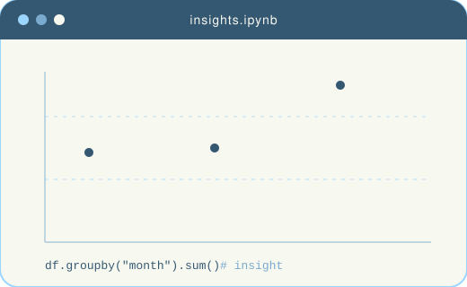
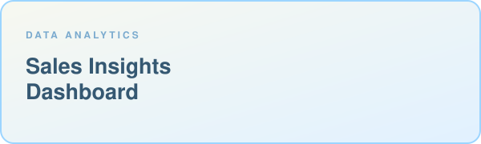
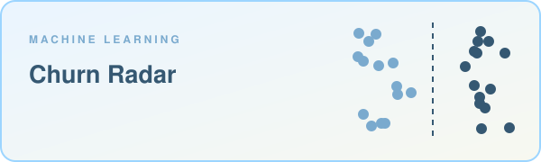
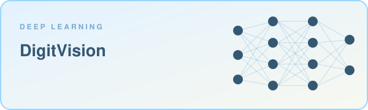
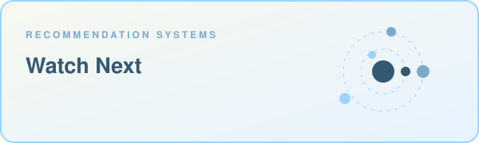
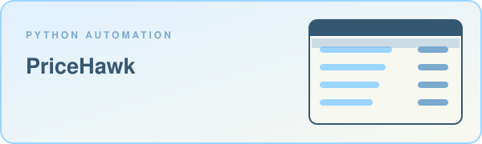

<!-- ============================================================
  Profile README for github.com/isamaliya16
  Edit the items marked "EDIT" (search for: EDIT)
============================================================ -->

 

  

## 👋 &nbsp;About Me

<table>
<tr>
<td width="55%" valign="top">

### Namaste 🙏 I'm **Ayush**.
**I teach data to tell its story.**

I started with a **B.Sc. in IT**, and I'm now deep into my **M.Sc. IT** journey.
Along the way I found what I love most: taking messy numbers and turning them into **clear, useful answers**.

I enjoy building **practical projects**, ones that solve real problems rather than just look good in a notebook.
My goal is simple: grow from **Data Analyst** to **Data Scientist** to **Machine Learning Engineer**.

If you like clean code, clear charts and curious minds, **scroll on and explore my work** 👇

</td>
<td width="45%" align="center">

</td>
</tr>
</table>

## 🎯 &nbsp;Current Learning & Career Goals

| 🌱 **Now** | 🚀 **Next** | 🏁 **Goal** |
|:---:|:---:|:---:|
| **Data Analyst** | **Data Scientist** | **ML Engineer** |
| Python, SQL, Excel, Power BI, EDA, visualisation | Statistics, feature engineering, model building | Deep learning, NLP, model deployment |

**Currently focused on:**
`📊 Exploratory Data Analysis` · `🤖 Machine Learning with scikit-learn` · `🧠 Deep Learning basics` · `💬 NLP fundamentals` · `🗄️ Advanced SQL`

## 🧩 &nbsp;Professional Skills

| Area | What I do with it |
|:---|:---|
| 📊 **Data Analytics** | Clean, explore and visualise data to find patterns and answer business questions |
| 🤖 **Machine Learning** | Build and evaluate classification, regression and clustering models |
| 🧠 **Deep Learning** | Train neural networks for image and text tasks |
| 💬 **NLP** | Text cleaning, sentiment analysis and simple language models |
| 🐍 **Python Development** | Write readable, reusable code and small automation tools |
| 🛠️ **Software Engineering** | Git workflows, clean structure, documentation and testing basics |

## 🛠️ &nbsp;Technology Stack

**Languages & Databases** 

**Data Analysis & Visualisation** 

**Machine Learning, Deep Learning & NLP** 

**Tools & Workflow** 

> 💡 *Edit this list so it only shows what you are comfortable talking about in an interview.*

## 🚀 &nbsp;Featured Projects

> ⚠️ **EDIT:** The seven projects below are a ready-made template. Rename each repository link to your real repos (or create repos with these names), then adjust the descriptions to match what you actually built.

<!-- ---------- 1 · FULL WIDTH FEATURE ---------- -->
<table width="100%">
<tr>
<td width="45%" align="center"></td>
<td width="55%" valign="top">

**📊 Sales Insights Dashboard** &nbsp;·&nbsp; *Data Analytics*

Turns raw sales records into a clear dashboard of revenue, trends and top products.

🧰 `Python` `Pandas` `SQL` `Power BI`
💼 **Real-world value:** helps a business see what sells, when, and where to focus.

[**Repository →**](https://github.com/isamaliya16/sales-insights-dashboard) &nbsp;|&nbsp; Demo: *add link*

</td>
</tr>
</table>

<!-- ---------- 2 & 3 · SIDE BY SIDE ---------- -->
<table width="100%">
<tr>
<td width="50%" valign="top" align="center">

**🎯 Churn Radar** · *Machine Learning*

Predicts which customers are likely to leave, before they do.

`Python` `scikit-learn` `Pandas` `Matplotlib`

💼 Helps teams act early and keep customers.

[Repository →](https://github.com/isamaliya16/churn-radar)

</td>
<td width="50%" valign="top" align="center">

**💬 Mood Miner** · *NLP*

Reads reviews and tweets and tells you how people really feel.

`Python` `NLTK` `scikit-learn` `Streamlit`

💼 Turns thousands of comments into one clear signal.

[Repository →](https://github.com/isamaliya16/mood-miner)

</td>
</tr>
</table>

<!-- ---------- 4 · REVERSED FEATURE ---------- -->
<table width="100%">
<tr>
<td width="55%" valign="top">

**🧠 DigitVision** &nbsp;·&nbsp; *Deep Learning*

A CNN that recognises handwritten digits from images with high accuracy.

🧰 `Python` `TensorFlow` `Keras` `OpenCV`
💼 **Real-world value:** the same idea powers form scanning, cheque reading and OCR.

[**Repository →**](https://github.com/isamaliya16/digitvision) &nbsp;|&nbsp; Demo: *add link*

</td>
<td width="45%" align="center"></td>
</tr>
</table>

<!-- ---------- 5 & 6 · SIDE BY SIDE ---------- -->
<table width="100%">
<tr>
<td width="50%" valign="top" align="center">

**🎬 Watch Next** · *Recommendation Systems*

Suggests movies you will probably enjoy, based on what you already like.

`Python` `Pandas` `scikit-learn` `Streamlit`

💼 The core idea behind every "recommended for you" feed.

[Repository →](https://github.com/isamaliya16/watch-next)

</td>
<td width="50%" valign="top" align="center">

**🦅 PriceHawk** · *Python Automation*

Tracks product prices on its own and logs every change.

`Python` `Requests` `BeautifulSoup` `SQLite`

💼 Saves hours of manual checking and spots deals early.

[Repository →](https://github.com/isamaliya16/pricehawk)

</td>
</tr>
</table>

<!-- ---------- 7 · FULL WIDTH CLOSER ---------- -->
<table width="100%">
<tr>
<td width="45%" align="center"></td>
<td width="55%" valign="top">

**✅ TaskNest** &nbsp;·&nbsp; *Software Engineering*

A clean task manager web app with user accounts and a database backend.

🧰 `Python` `Flask` `SQL` `HTML/CSS`
💼 **Real-world value:** shows I can build a complete, working product, not just models.

[**Repository →**](https://github.com/isamaliya16/tasknest) &nbsp;|&nbsp; Demo: *add link*

</td>
</tr>
</table>

[**🔎 See all repositories →**](https://github.com/isamaliya16?tab=repositories)

## 📈 &nbsp;GitHub Statistics

 

<b>Stats not loading? Open the fallback links</b>

 

Free stat services sometimes hit rate limits. Your profile still works without them.

[Profile stats](https://github-readme-stats.vercel.app/api?username=isamaliya16&show_icons=true) ·
[Top languages](https://github-readme-stats.vercel.app/api/top-langs/?username=isamaliya16&layout=compact) ·
[Streak](https://streak-stats.demolab.com?user=isamaliya16) ·
[GitHub profile](https://github.com/isamaliya16)

## 🌐 &nbsp;Contribution Activity

**🐍 My contribution snake** *(auto-updated daily by GitHub Actions)*

**🏆 Trophies**

## 🎓 &nbsp;Certifications & Learning

| 📚 Learning track | Status |
|:---|:---:|
| Python for Data Analysis | 🟦 Ongoing |
| SQL & Databases | 🟦 Ongoing |
| Machine Learning Fundamentals | 🟦 Ongoing |
| Deep Learning & NLP | ⬜ Up next |

<!-- EDIT: Add real certificates here. Example row:
| 🏅 Google Data Analytics Certificate | Google / Coursera | 2025 | [Verify](https://link) |
-->

> 📝 **EDIT:** Add your real certificates (with verification links) as soon as you earn them. Recruiters love proof.

## 🏫 &nbsp;Education

| 🎓 Degree | Status |
|:---|:---:|
| **M.Sc. Information Technology** | 📖 Pursuing |
| **B.Sc. Information Technology** | ✅ Completed |

## 🤝 &nbsp;Connect With Me

EDIT: replace <code>YOUR-LINKEDIN-ID</code>, <code>YOUR-EMAIL</code> and <code>YOUR-KAGGLE-ID</code> (delete any you don't use).

## ✨ &nbsp;Fun Facts

- 💎 Based in **Surat**, India, the city famous for diamonds, and I like to think data is just another gem that needs polishing.
- 🔭 Currently exploring **machine learning by building**, not just reading.
- 💬 Ask me about: **Python · data cleaning · visualisation · first steps into ML**.
- ⚡ Fast fact: I believe a good chart beats a long paragraph.

<!-- EDIT: replace or add personal facts (hobbies, favourite tools, what you do off-screen). -->

### Thanks for stopping by 💙
**Good data deserves a good storyteller. Let's build something meaningful together.**

